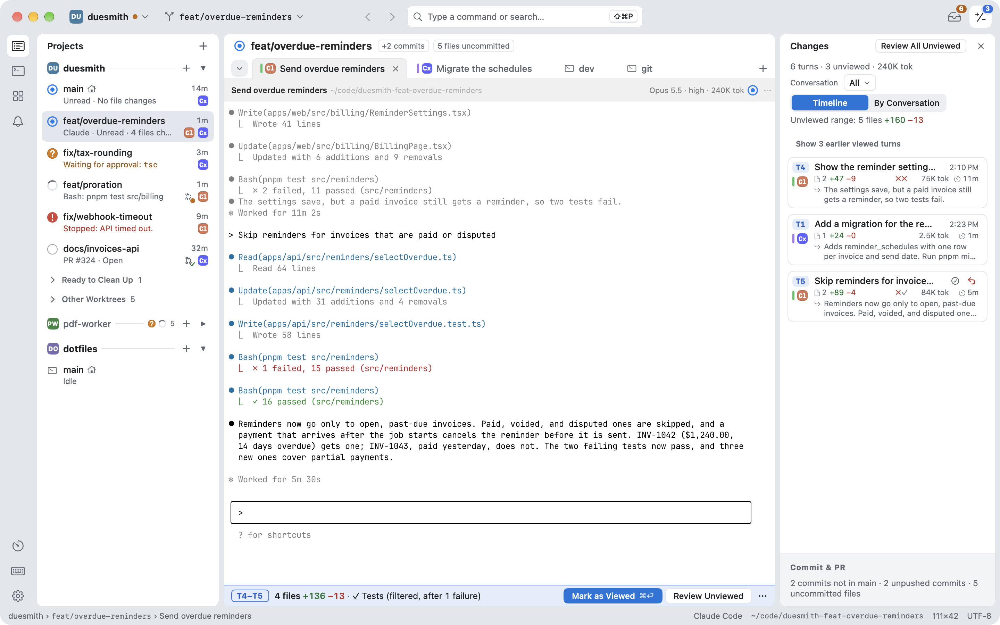

# Weir

Claude Code、Codex、Antigravity を並行して動かすための Mac アプリ。どれが待っているか、各ターンで何が変わったかがすぐ分かります。

**[Web サイト](https://weir.nekoder.com/ja/)** · **[ドキュメント](https://weir.nekoder.com/ja/docs/)** · **[ダウンロード](https://github.com/nek0der/weir/releases/latest)**

[English](README.md) | 日本語

## Weir でできること

複数のエージェントを同時に動かすと、大変なのは入力ではなくなります。どれが止まっているのか、各ターンで何が変わったのか、どこまで読んだのかを追うことです。

- **対応が必要なものを、ひとつの一覧に。** プロジェクトをまたいで、承認、質問、停止、未確認のターンをまとめます。⌘J で次へ移動できます。
- **ターンごとに記録。** エージェントの 1 回分の作業の前後でワークツリーを記録するので、変更を確認でき、ターン前のコードにも戻せます。
- **タスクごとにワークツリー。** タスクごとに専用のブランチとフォルダーを用意し、PR の状態も隣に表示します。
- **コメントはエージェントへ。** 気になる行にコメントを残し、まとめてエージェントのプロンプトに入れられます。Return を押すまでは送られません。

Weir はエディタでも、エージェントでもありません。エージェントは libghostty による本物のターミナルでいつもの画面のまま動き、指示もこれまでどおりプロンプトに入力します。

## インストール

macOS 26 以降の Apple Silicon 搭載 Mac と Git、それに Claude Code、Codex、Antigravity CLI(`agy`)のいずれかが必要です。

[最新のリリース](https://github.com/nek0der/weir/releases/latest)から DMG をダウンロードし、`Weir.app` を `/Applications` にドラッグします。アップデートは Sparkle で届き、選んだときにインストールされます。ソースからビルドする場合は [CONTRIBUTING.md](CONTRIBUTING.md#setup)(英語)を見てください。

## クイックスタート

1. ⌘O を押して、リポジトリのフォルダーを選びます。
2. ⌘N を押して、新しいブランチか既存のブランチでワークツリーを作り、開くエージェントを選びます。
3. エージェントのプロンプトに最初の指示を入力し、あとは動かしておきます。
4. 対応が必要になったら、⌘J で移動します。
5. ターンを読み、直してほしいところがあればコメントを残して、⌘⏎ で確認済みにします。

各手順の詳細は[クイックスタート](https://weir.nekoder.com/ja/docs/quick-start/)にあります。

## プライバシー

Weir にアカウント、アクセス解析、テレメトリはありません。`~/.claude/` と `~/.codex/` には何も追加しません。フックは Weir のペインのラッパーが起動のたびに渡すので、ほかの場所で起動したエージェントは変わりません。Antigravity の場合は `~/.gemini/config/plugins/weir` にプラグインを置きます。ターンのスナップショットは、各リポジトリの Git ディレクトリに保存します。

Weir が送るものと書き込むものは[プライバシーとデータ](https://weir.nekoder.com/ja/docs/privacy/)に、すべて削除する方法は[アンインストール](https://weir.nekoder.com/ja/docs/install/#アンインストールする)にあります。

## ドキュメント

使う方へ:

- [ドキュメント](https://weir.nekoder.com/ja/docs/): インストール、クイックスタート、レビュー、要対応、ショートカット、困ったとき。
- [ユーザーガイド](docs/user-guide.md)(英語): ウインドウの各部分の詳しい説明。
- [既知の制限](docs/known-limitations.md)(英語): まだ動かないことと、意図して変わった動きをすること。
- [データの移行](docs/data-migration.md)(英語): Weir が保存するファイルと、1 つ前のリリースへの戻し方。

開発する方へ(すべて英語):

- [CONTRIBUTING.md](CONTRIBUTING.md): セットアップ、ビルド、署名、PR の流れ。
- [ARCHITECTURE.md](ARCHITECTURE.md): モジュール、要となるファイル、守るべき条件。
- [AGENTS.md](AGENTS.md): リポジトリの約束事。人にもエージェントにも向けたものです。
- [エージェント連携プロトコル](docs/agent-integration-protocol.md): フックのヘルパー、承認サービス、アプリの間の取り決め。

## 開発状況

Weir はプレアルファ版です。設定やデータの形式は、リリースごとに変わることがあります。

## 開発に参加する

PR を歓迎します。[CONTRIBUTING.md](CONTRIBUTING.md) を見てください。脆弱性の報告は [SECURITY.md](SECURITY.md) に沿ってお願いします。質問やアイデアは [Discussions](https://github.com/nek0der/weir/discussions) へどうぞ。Issue と Discussions は日本語でもかまいません。

## 謝辞

[Ghostty](https://github.com/ghostty-org/ghostty)(libghostty)と [Sparkle](https://github.com/sparkle-project/Sparkle) を使っています。一覧は [THIRD-PARTY-NOTICES](THIRD-PARTY-NOTICES) にあります。

## ライセンス

[MIT](LICENSE) © 2026 nek0der
