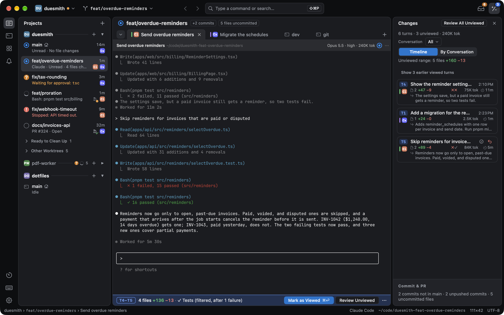

Weir is a native Mac app for running Claude Code and Codex side by side. It shows which agent needs you and what changed in each turn, one round of an agent's work.

The agents keep their own terminal UI. You still type in their prompts, and Weir runs them in its panes and tracks their state. It is not an editor, and it is not an agent.

Weir is pre-alpha. Settings and data formats may change between releases.

## Start here

1. [Install Weir](/docs/install/).
2. [Run your first agent and review its turn](/docs/quick-start/).
3. Read the [concepts](/docs/concepts/) when a word on screen is unfamiliar.

## Find what you need

- [Review changes](/docs/review/): read a turn, comment on it, or put the code back.
- [Needs Attention and approvals](/docs/needs-attention/): go to the next agent that is waiting.
- [Keyboard shortcuts](/docs/shortcuts/): the default keys.
- [Troubleshooting](/docs/troubleshooting/): when something looks wrong.
- [Privacy and data](/docs/privacy/): what Weir sends and what it keeps.

The [user guide](https://github.com/nek0der/weir/blob/main/docs/user-guide.md) on GitHub covers every part of the window in more detail.
