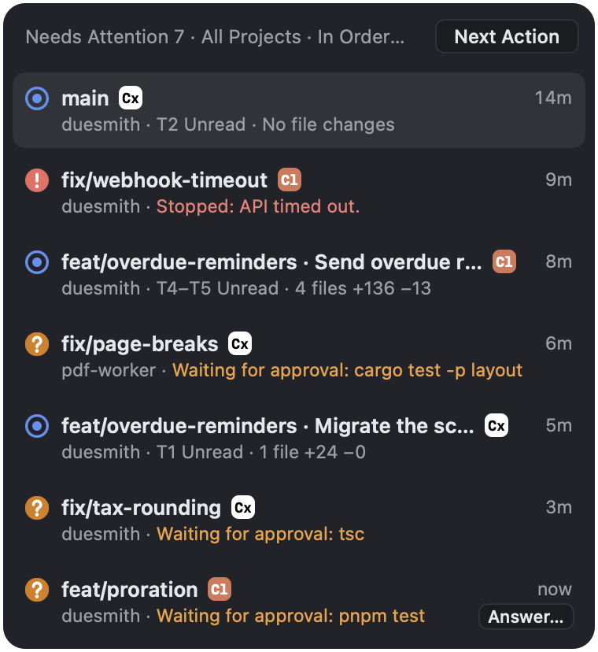
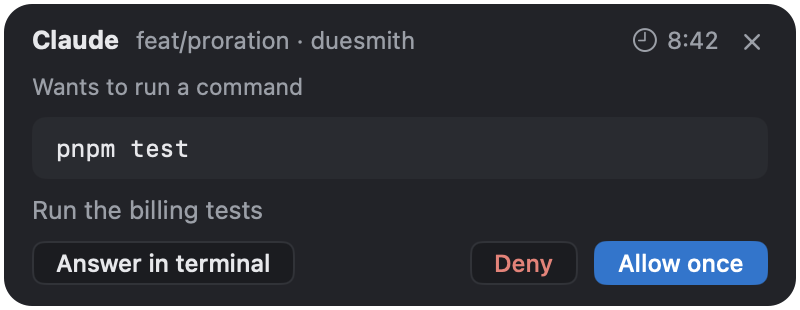

## The list

**Needs Attention** holds what is waiting for you across every project, in the order it arrived: approvals, questions, stops, and unviewed turns.

An agent waiting for approval, an answer, a response, or a sign-in shows an amber disc with a question mark. A stopped agent shows a red disc with an exclamation mark, a running one shows a gray arc, and an unread turn shows a blue ring with a dot in the center. The **Needs Attention** count is amber when any item needs a response or has stopped, and blue when only unread turns remain. The menu bar uses a large filled disc for the former and a small dot for unread turns alone. An overlapping-window icon and a location label identify items in another window.

| Key | What it does |
|---|---|
| <kbd>⌘J</kbd> | Go to the next item |
| <kbd>⇧⌘J</kbd> | Go to the previous item |
| <kbd>⌥⌘J</kbd> | Open the list |

A turn that changed files stays in the list until you [mark it as viewed](/docs/review/#mark-turns-as-viewed).

To see every project's worktrees grouped by state, press <kbd>⇧⌘O</kbd> for **All Projects**.

## Answer an approval

Weir holds each request until you answer it, wherever its pane is. You answer it on the approval card, which opens from any of these:

| Where | How |
|---|---|
| The bar under the agent's pane | Choose **Answer…**, or press <kbd>⌘⏎</kbd> |
| The **Needs Attention** list | Choose **Answer…** |
| The worktree's sidebar row | Hover over it and choose **Answer…** |
| **All Projects** | Choose the worktree's **Answer…** |
| The menu bar, while another app is in front | A short, low-impact shell command can be answered right there. For any other request, choose **Answer…** to open Weir |

The card opens next to where you chose **Answer…**, in the same window. If you opened it from a row in a list or the sidebar, that row stays highlighted while the card is open.

Going to the pane leaves the request with Weir, so you can still answer it on the card after you leave. Claude Code and OpenCode also show their own prompts in the pane, and whichever you answer first counts. Codex shows its prompt only after you choose **Answer in terminal** or the request times out.

**Answer in terminal** on the card, or in the bar's **⋯** menu, goes to the pane and sends the request to the agent's prompt. After that you answer it there. The card shows the time left. Once a request times out, you answer it in the terminal.

When you quit Weir, every request it still holds goes to the agent's prompt. An answer you chose just before quitting is sent instead, and the agent gets it once.

Weir adds no "always allow" option and writes nothing to an agent's settings. To always allow something, use the agent's own prompt.

Codex questions are always answered in the terminal.

Antigravity has no approval card. Its approvals and questions are always answered in its own prompt, and Weir shows that it waits. A subagent's approval does not always show as a wait: `agy` shows it as Blocked, and <kbd>⌃K</kbd> there approves it.

Kiro has no approval card either. Its approvals are answered in its own prompt, and Weir shows that it waits.

For OpenCode, you choose **Allow always** and answer its questions only at its own prompt.

Each of OpenCode's tabs is watched on its own, so a wait or a failure in a tab behind the one on screen still reaches you here. Going to it, or choosing **Answer in terminal** for its request, brings its tab forward. The pane's badge shows the most urgent of its tabs.

## After a stop

When an agent stops on an API error or a usage limit, or exits, the bar under its pane offers:

- **Resume Same Conversation**, to pick up where it left off
- **Show Partial Changes** and **Start New Conversation**, in its **⋯** menu

If a usage limit stopped it, Weir can also notify you when the limit resets. Antigravity reports a limit only in its error message. If Weir does not recognize the wording, the stop looks like any other error. If the message has no reset time Weir can read, no notification is offered.

OpenCode reaches many services and models, so a limit on one of them does not mark your other OpenCode panes. Its stop offers **Resume** rather than the notification, since changing the model may be all it takes.

## An agent that runs without asking

When an agent is set to run every action without asking, its pane header shows a warning icon. Its tooltip says **Runs without asking**, and VoiceOver reads the same warning with the header. For OpenCode, the icon shows only when you start OpenCode with `--auto`. Weir cannot see auto-approval set in OpenCode's config file, so that setting shows no icon.
