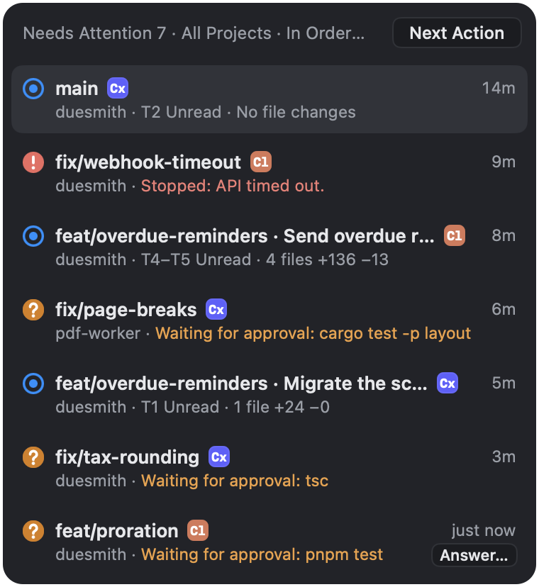
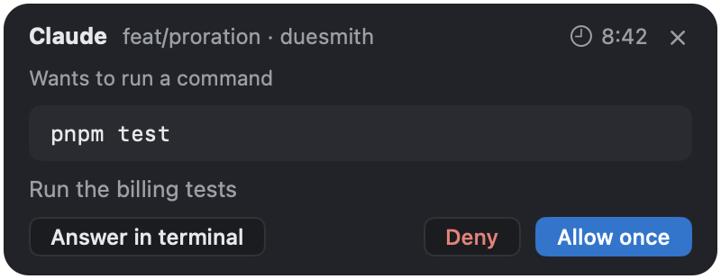

## The list

**Needs Attention** holds what is waiting for you across every project, in the order it arrived: approvals, questions, stops, and unviewed turns.

| Key | What it does |
|---|---|
| <kbd>⌘J</kbd> | Go to the next item |
| <kbd>⇧⌘J</kbd> | Go to the previous item |
| <kbd>⌃⌘J</kbd> | Open the list |

A turn that changed files stays in the list until you [mark it as viewed](/docs/review/#mark-turns-as-viewed).

To see every project's worktrees grouped by state, press <kbd>⌥⌘O</kbd> for **All Projects**.

## Answer an approval

Where a request appears depends on what you are looking at.

| When | Where the request goes |
|---|---|
| You can see the agent's pane | The agent's own prompt |
| The pane is out of sight | It waits. To answer without switching panes, choose **Answer…** in the **Needs Attention** list to open the approval card. The button also appears when you hover over the worktree's sidebar row. If you go to the pane, the request moves to the agent's prompt |
| Another app is in front | It waits. The menu bar can answer a short, low-impact shell command. For any other request, choose **Answer…** there to open Weir |

**Answer in terminal** on the card goes to the pane and sends the request to the agent's prompt. The card shows the time left. Once a request times out, you answer it in the terminal. While VoiceOver is running, a request does not move to the prompt on its own, so answer on the card or choose this.

Weir adds no "always allow" option and writes nothing to an agent's settings. To always allow something, use the agent's own prompt.

Codex questions are always answered in the terminal.

## After a stop

When an agent stops on an API error, a usage limit, or by exiting, the bar under its pane offers:

- **Resume Same Conversation**, to pick up where it left off
- **Show Partial Changes** and **Start New Conversation**, in its **⋯** menu

If a usage limit stopped it, Weir can also notify you when the limit resets.

## An agent that runs without asking

When an agent is set to run every action without asking, its pane header says **Runs without asking** beside a warning sign, so you can tell at a glance.
