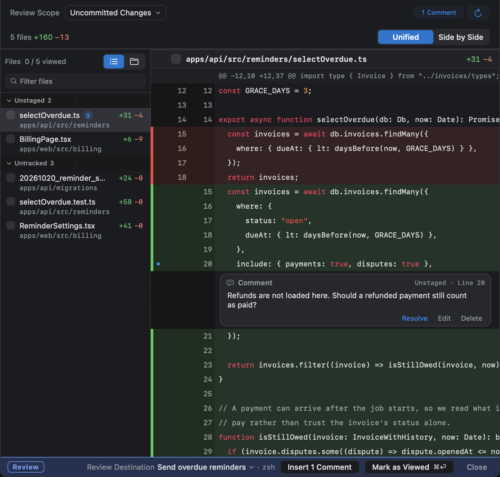

## Open a review

Each of these opens a review tab in place of the terminal:

- **Review Unviewed** on the bar under the agent's pane
- **Review All Unviewed** in the Changes panel (<kbd>⌥⌘I</kbd>)
- <kbd>⌥⌘R</kbd>
- <kbd>⌥⌘J</kbd>, for the focused agent's latest turn

Use the scope menu to choose what the review shows: one conversation's unviewed turns, all unviewed turns in the worktree, a single turn, the uncommitted changes, or the branch against its base.

## Send comments to the agent

Click the number of a line you want changed, press <kbd>C</kbd>, write your comment, and choose **Add**. Then choose **Insert *n* Comments**. Weir puts the comments into the agent's input as one message, and you press <kbd>Return</kbd> to send it.

Comments survive a restart. A comment whose code has moved since you wrote it is held back rather than sent.

## Mark turns as viewed

**Mark as Viewed** (<kbd>⌘⏎</kbd>) moves the [viewed line](/docs/concepts/#viewed-line) past the turns you read, and they leave **Needs Attention**. If you change your mind, **Unmark as Viewed** takes it back.

## Undo changes

Weir has two ways to put code back. **Undo Discard** and **Undo Restore** reverse them.

| To undo | Use | What it changes |
|---|---|---|
| One block of changes | **Discard** on a hunk in the review | That hunk |
| A turn and everything after it | **Restore Code to Before This Turn…** on a card in the Changes panel, or in the bar's **⋯** menu while the turn is unviewed. With several unviewed turns, the bar names the first by number | The working tree |

A restore leaves the conversation, staged changes, and commits alone. The bar then says the restore is not reflected in the conversation, and offers **Undo Restore**.

Weir checks the files before and after restoring, and stops if an agent or an editor changed them. Another program can still write in between, so avoid restoring while an agent in the same worktree is working.

## Finish the task

**Commit & PR** at the bottom of the Changes panel shows what is not yet in the base branch or not yet pushed. It offers **Create PR**, which needs `gh`, and **Clean Up Worktree…**.
