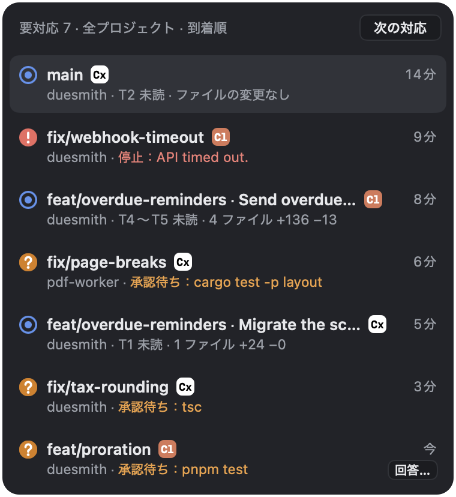
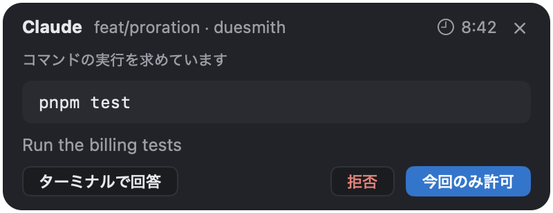

## 一覧

**要対応** には、すべてのプロジェクトで対応を待っているものが到着順に並びます。承認、質問、停止、未確認のターンです。

| キー | 動作 |
|---|---|
| <kbd>⌘J</kbd> | 次へ移動 |
| <kbd>⇧⌘J</kbd> | 前へ移動 |
| <kbd>⌃⌘J</kbd> | 一覧を開く |

ファイルを変更したターンは、[確認済みにする](/ja/docs/review/#ターンを確認済みにする)まで一覧に残ります。

すべてのプロジェクトのワークツリーを状態ごとに見るには、<kbd>⌥⌘O</kbd> で **すべてのプロジェクト** を開きます。

## 承認に答える

依頼は、ペインがどこにあっても、答えるまで Weir が預かります。答えるのは承認カードで、次のどこからでも開けます。

| 場所 | 開き方 |
|---|---|
| エージェントのペインの下のバー | **回答…** を選ぶか、<kbd>⌘⏎</kbd> を押します |
| **要対応** の一覧 | **回答…** を選びます |
| サイドバーのワークツリーの行 | カーソルを合わせて **回答…** を選びます |
| 他のアプリが前面にあるときのメニューバー | 短くて影響の小さいシェルコマンドは、その場で答えられます。それ以外は **回答…** で Weir を開きます |

ペインに移動しても、依頼は Weir が預かったままです。ペインを離れたあとも、カードで答えられます。Claude Code と OpenCode はペインにも自分のプロンプトを出し、先に答えたほうが使われます。Codex がプロンプトを出すのは、**ターミナルで回答** を選んだときか、時間切れになったときです。

カードかバーの **⋯** メニューで **ターミナルで回答** を選ぶと、そのペインに移動して、依頼をエージェントのプロンプトに渡します。そのあとはプロンプトで答えます。カードには残り時間が表示され、時間切れになった依頼にはターミナルで答えます。

Weir に「常に許可」の選択肢はなく、エージェントの設定にも何も書き込みません。常に許可したいときは、エージェントのプロンプトで選んでください。

Codex の質問には、常にターミナルで答えます。

Antigravity には承認カードがありません。承認にも質問にも常にそのプロンプトで答え、Weir には待っていることだけが表示されます。サブエージェントの承認待ちは Weir に表示されないことがあります。`agy` に Blocked と表示されるので、`ctrl+k` で承認します。

OpenCode では、**常に許可** と質問への回答は OpenCode のプロンプトでのみ行えます。

OpenCode のタブはそれぞれ別に見守ります。表示中のタブの裏で起きた承認待ちや失敗もここに届きます。そこへ移動するか、その依頼で **ターミナルで回答** を選ぶと、そのタブが前面に出ます。ペインのバッジには、そのペインのタブのうちいちばん急ぐものが出ます。

## 止まったとき

API エラーや使用量の上限、終了などでエージェントが止まると、ペインの下のバーに次の項目が出ます。

- **同じ会話で再開**: 止まったところから続けます。
- **途中までの変更を表示** と **新しい会話で開始**: **⋯** メニューにあります。

使用量の上限で止まったときは、上限がリセットされたら通知を受け取ることもできます。Antigravity は上限をエラーの文面でしか伝えません。Weir が読み取れない文面なら通常の停止として表示され、リセット時刻が読めなければ通知は選べません。

OpenCode は複数のサービスとモデルを使うので、そのうち 1 つが上限に達しても、ほかの OpenCode のペインには上限の表示が付きません。モデルを変えれば続けられることがあるので、停止には通知ではなく **再開** が出ます。

## 確認なしで動くエージェント

すべての操作を確認なしで実行する設定のエージェントは、ペインのヘッダーに警告マークと **確認なしで実行** が表示されます。
