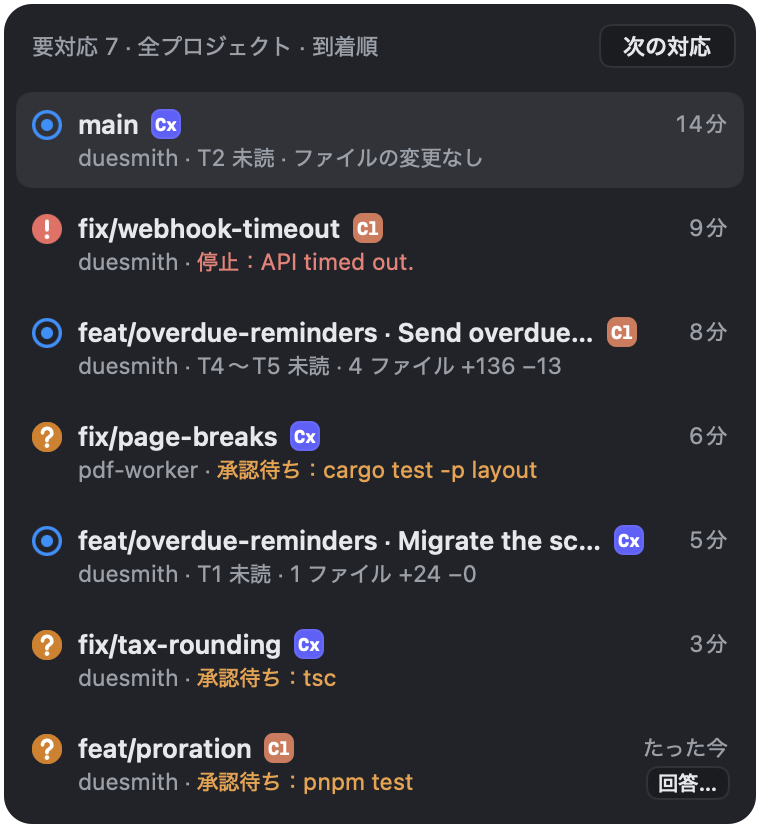
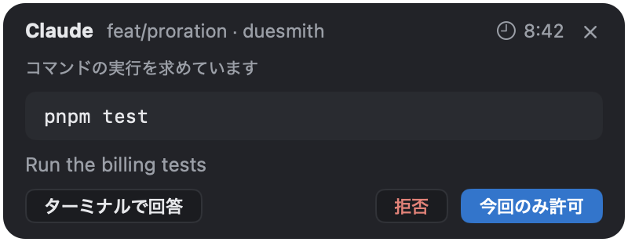

## 一覧

**要対応** には、すべてのプロジェクトで対応を待っているものが到着順に並びます。承認、質問、停止、未確認のターンです。

| キー | 動作 |
|---|---|
| <kbd>⌘J</kbd> | 次へ移動 |
| <kbd>⇧⌘J</kbd> | 前へ移動 |
| <kbd>⌃⌘J</kbd> | 一覧を開く |

ファイルを変更したターンは、[確認済みにする](/ja/docs/review/#ターンを確認済みにする)まで一覧に残ります。

すべてのプロジェクトのワークツリーを状態ごとに見るには、<kbd>⌥⌘O</kbd> で **すべてのプロジェクト** を開きます。

## 承認に答える

依頼がどこに出るかは、今見ているものによって変わります。

| 状況 | 依頼が出る場所 |
|---|---|
| エージェントのペインが見えている | エージェントのプロンプト |
| ペインが見えていない | 待機します。**要対応** の一覧にある **回答…** で承認カードを開くと、ペインを切り替えずに答えられます。このボタンは、サイドバーのワークツリーの行にカーソルを合わせても出ます。ペインに移動すると、依頼はエージェントのプロンプトに移ります |
| 他のアプリが前面にある | 待機します。短くて影響の小さいシェルコマンドはメニューバーから答えられます。それ以外はメニューバーの **回答…** で Weir を開きます |

カードの **ターミナルで回答** を選ぶと、そのペインに移動して、依頼をエージェントのプロンプトに渡します。カードには残り時間が表示され、時間切れになった依頼にはターミナルで答えます。VoiceOver を使っている間は、依頼が自動でプロンプトに移らないので、カードで答えるかこれを選んでください。

Weir に「常に許可」の選択肢はなく、エージェントの設定にも何も書き込みません。常に許可したいときは、エージェントのプロンプトで選んでください。

Codex の質問には、常にターミナルで答えます。

Antigravity には承認カードがありません。承認にも質問にも常にそのプロンプトで答え、Weir には待っていることだけが表示されます。サブエージェントの承認待ちは Weir に表示されないことがあります。`agy` に Blocked と表示されるので、`ctrl+k` で承認します。

## 止まったとき

API エラーや使用量の上限、終了などでエージェントが止まると、ペインの下のバーに次の項目が出ます。

- **同じ会話で再開**: 止まったところから続けます。
- **途中までの変更を表示** と **新しい会話で開始**: **⋯** メニューにあります。

使用量の上限で止まったときは、上限がリセットされたら通知を受け取ることもできます。Antigravity は上限をエラーの文面でしか伝えません。Weir が読み取れない文面なら通常の停止として表示され、リセット時刻が読めなければ通知は選べません。

## 確認なしで動くエージェント

すべての操作を確認なしで実行する設定のエージェントは、ペインのヘッダーに警告マークと **確認なしで実行** が表示されます。
