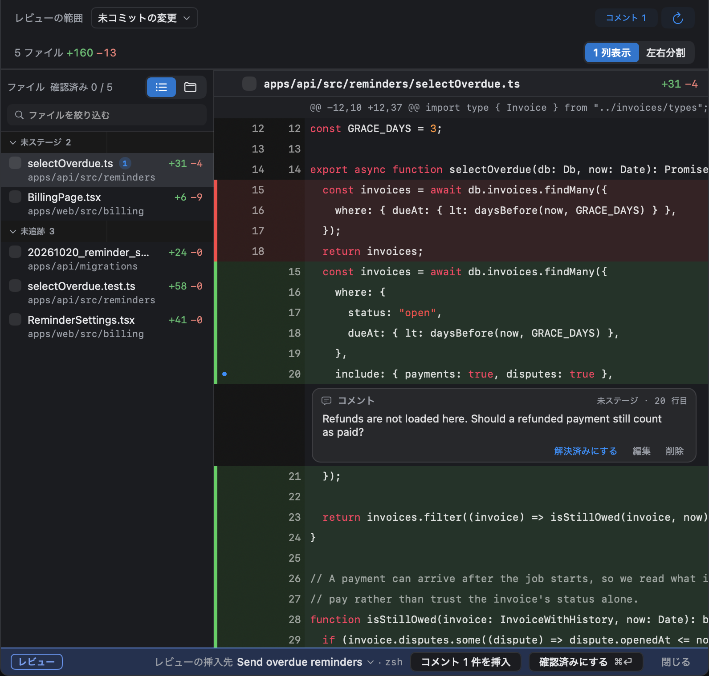

## レビューを開く

次のどれかで、ターミナルの場所にレビューのタブが開きます。

- エージェントのペインの下のバーにある **未確認をレビュー**
- 変更パネル（<kbd>⌥⌘I</kbd>）の **すべての未確認をレビュー**
- <kbd>⌥⌘R</kbd>
- <kbd>⌥⌘J</kbd>（フォーカス中のエージェントの最新のターン）

スコープのメニューで、表示する範囲を選びます。1 つの会話の未確認のターン、ワークツリーのすべての未確認のターン、1 つのターン、未コミットの変更、ベースブランチとの差分から選べます。

## エージェントにコメントを送る

直してほしい行の番号をクリックして <kbd>C</kbd> を押し、コメントを書いて **追加** を選びます。そのあと **コメント *n* 件を挿入** を選びます。コメントが 1 つのメッセージとしてエージェントの入力欄に入るので、<kbd>Return</kbd> を押して送ります。

コメントは再起動しても残ります。書いた後で該当のコードが移動したコメントは、送らずに保留されます。

## ターンを確認済みにする

**確認済みにする**（<kbd>⌘⏎</kbd>）で、読み終えたターンの先まで[確認済みの線](/ja/docs/concepts/#確認済みの線)を進めます。ターンは **要対応** から消えます。戻したいときは **確認済みを取り消す** を使います。

## 変更を元に戻す

元に戻す方法は 2 つあります。やり直したいときは、**破棄を取り消す** と **復元を取り消す** を使います。

| 戻したいもの | 使うもの | 変わるもの |
|---|---|---|
| 変更の 1 まとまり | レビューのハンクの **破棄** | そのハンク |
| あるターンとそれ以降の変更すべて | 変更パネルのカードにある **このターンの前にコードを復元…**。未確認のターンならバーの **⋯** メニューにもあります。未確認のターンが複数あるときは、バーでは最初のターンを番号で示します | 作業ツリー |

復元しても、会話、ステージした変更、コミットはそのままです。このあとバーには、会話に反映されていないことと **復元を取り消す** が表示されます。

Weir は復元の前後でファイルを確かめ、エージェントやエディタが変更していたら止まります。その間に別のプログラムが書き込むことは防げないので、同じワークツリーでエージェントが作業している間の復元は避けてください。

## タスクを仕上げる

変更パネルの下にある **コミットと PR** に、ベースブランチに入っていないものや、まだ push していないものが表示されます。**PR を作成**（`gh` が必要です）と **ワークツリーを片付ける…** もここにあります。
